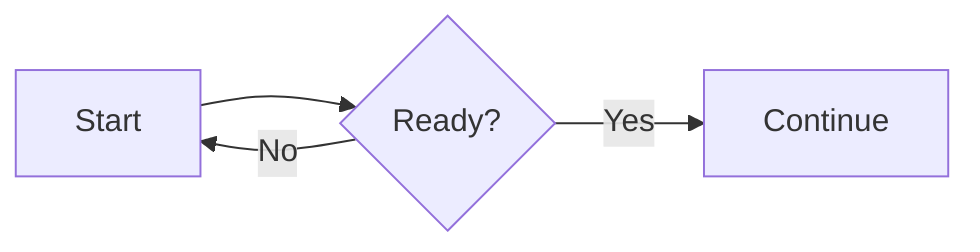

# Learper

Learper is a local macOS quiz app built with SwiftUI. Import a multiple-choice (MCQ) or short-answer (SAQ) quiz generated by a chatbot, answer one question at a time, reveal hints, and review your work afterward. It starts with a sample quiz so you can try the interface immediately.

## Build and run

Requires macOS 13 or newer and Apple Command Line Tools (or Xcode). No account or API key is required.

```sh
./scripts/build_app.sh
open .build/app/Learper.app
```

The Swift Package can also be opened in Xcode from `Package.swift`. With a full Xcode installation, `swift build` and `swift test` are available. The build script uses `swiftc` directly so it also works on Macs with only Command Line Tools.

Run `./scripts/test.sh` for the full model, session, and persistence suite with a coverage report. It executes the same test cases through a small assertion adapter when only Command Line Tools are installed; Xcode uses XCTest directly via `swift test`. The quick integration smoke check remains available as `./scripts/smoke_test.sh`.

Run `./scripts/graph_test.sh` for legacy graph parser, Mermaid, and WebKit rendering checks. The app and tests do not need Node.js; Mermaid is bundled in the repository. The views use a `ViewState` alias for SwiftUI's `State` property wrapper so SDKs that also expose a `State` macro still build with Command Line Tools.

## Make a quiz with any chatbot

Choose **Create with AI** in Learper's sidebar, enter a topic or notes, choose **Multiple choice** or **Short answer**, the question count and difficulty, and click **Copy full prompt**. Paste it into any chatbot. The prompt includes the complete [portable question format](docs/QUESTION_FORMAT.md) and asks for a downloadable `learper-quiz.json` file. Download that file and choose **Import JSON** in Learper. If a chat interface cannot create downloadable files, it can return JSON text for you to save or paste with **Paste JSON**. A matching set ID replaces the earlier imported set. Older quiz files without a `type` field continue to work as MCQs.

MCQs have 2–6 choices, one correct choice ID, and an explanation. Learper grades them as you go. SAQs have a written answer field and no automatic grading. At the end, **Copy questions and answers for grading** copies every question, your response, and any reference answer or grading guidance into a prompt you can paste into your chatbot. Both formats support hints and optional context. Rich text supports Markdown, C/C++/Python/Rust code highlighting, and LaTeX.

## Draw graphs from text

Choose **Create Graph** to type Mermaid syntax and see a live preview. For example:



Use **Copy Mermaid block** to copy a fenced `mermaid` block for quiz text, or **Export SVG…** to save a scalable image. The editor saves your latest draft locally. Mermaid also supports sequence diagrams, class diagrams, and other diagram types.

Chatbots can include a fenced `mermaid` block in questions, context, hints, choices, or explanations. Learper renders these diagrams offline. The older fenced `graph` syntax remains supported for already imported quizzes. See the [question format](docs/QUESTION_FORMAT.md#rich-text-and-diagrams) and [graph theory example](Sources/Learper/Resources/graph-theory-quiz.json).

Click anywhere in an MCQ answer row to select it. Keyboard shortcuts **1–4** select the first four choices; **Space** checks the selected answer, then advances after feedback. After the last MCQ, **Statistics** shows correct, missed, and accuracy totals; **All questions** shows every answer and explanation. Right-click any quiz in the sidebar to **Open**, **Rename**, or **Delete** it.

Imported quizzes are saved in `~/Library/Application Support/Learper/library.json`. Quiz content stays on the Mac. The app does not call a model or other service itself.

## Project map

- `Sources/Learper/QuizModels.swift`: v1 JSON data model and validation.
- `Sources/Learper/QuizLibrary.swift`: JSON import and local persistence.
- `Sources/Learper/QuizSession.swift`: answer, hint, and progress state.
- `Sources/Learper/ContentView.swift`: SwiftUI interface.
- `Sources/Learper/QuizPrompt.swift` and `Resources/QUESTION_FORMAT.md`: in-app prompt generation and bundled format.
- `Sources/Learper/RichTextView.swift` and `Resources/Web`: offline rich-text rendering.
- `Sources/Learper/GraphEditorView.swift` and `Resources/Web/vendor/mermaid`: Mermaid editor and offline diagram renderer. `Resources/Web/graph.js` supports older `graph` blocks.
- `docs/QUESTION_FORMAT.md`: agent-facing generation contract.
- `Tests/LearperTests`: model and quiz behavior tests.

The renderer bundles Markdown-it, KaTeX, highlight.js, and Mermaid under their included licenses in `Resources/Web/vendor`. No external CDN is used at runtime. On macOS 26 with a recent Xcode compiler, the dark cards use the system glass effect with purple accents. Earlier macOS versions use tinted translucent materials.

## Current scope

Plain quiz text uses native SwiftUI text; Markdown, math, code, and graphs use WebKit. Results load rows lazily. The web renderer reuses unchanged content and batches height updates, measuring content independently of the viewport so shorter questions can shrink correctly. `scripts/test.sh` checks renderer routing and reports how many sample fields avoid WebKit; `scripts/graph_test.sh` checks DOM reuse, height shrinkage, and math/code/graph rendering in WebKit.

Learper handles imported single-answer MCQs and SAQs. Sessions run in memory; imported sets persist, while answers and scores reset when the app quits or a set is reopened. Image fields are accepted for forward compatibility and intentionally ignored by the renderer.
