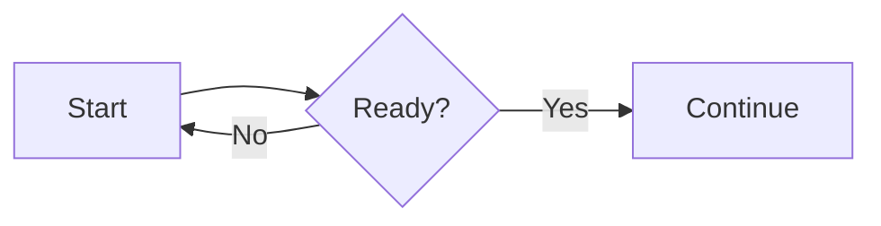

# Learper

Learper is a local macOS quiz app built with SwiftUI. Import a multiple-choice (MCQ) or short-answer (SAQ) quiz generated by a chatbot, answer one question at a time, reveal hints, and review your work afterward. It starts with a sample quiz so you can try the interface immediately.

## Build and run

Requires macOS 13 or newer and Apple Command Line Tools (or Xcode). No account or API key is required.

```sh
./scripts/build_app.sh
open .build/app/Learper.app
```

The Swift Package can also be opened in Xcode from `Package.swift`. With a full Xcode installation, `swift build` and `swift test` are available. The build script uses `swiftc` directly so it also works on Macs with only Command Line Tools.

Run `./scripts/test.sh` for the full model, session, and persistence suite with a coverage report. It executes the same test cases through a small assertion adapter when only Command Line Tools are installed; Xcode uses XCTest directly via `swift test`. The quick integration smoke check remains available as `./scripts/smoke_test.sh`.

Run `./scripts/graph_test.sh` for legacy graph parser, Mermaid, and WebKit rendering checks. The app and tests do not need Node.js; Mermaid is bundled in the repository. The views use a `ViewState` alias for SwiftUI's `State` property wrapper so SDKs that also expose a `State` macro still build with Command Line Tools.

## Make a quiz with any chatbot

Choose **Create with AI** in Learper's sidebar, enter a topic or notes, choose **Multiple choice** or **Short answer**, the question count and difficulty, and click **Copy full prompt**. For MCQs, select **Include select-all-that-apply questions** if you want some questions with several correct choices. Paste the prompt into any chatbot. It includes the complete [portable question format](docs/QUESTION_FORMAT.md) and asks for a downloadable `learper-quiz.json` file. Download that file and choose **Import JSON** in Learper. If a chat interface cannot create downloadable files, it can return JSON text for you to save or paste with **Paste JSON**. A matching set ID replaces the earlier imported set. Older quiz files without a `type` field continue to work as MCQs.

MCQs have 2–6 choices and an explanation. A question may have one correct choice or several; select-all questions let you toggle choices and are correct only when the full selection matches. Learper grades MCQs as you go. If you cannot answer, choose **I don't know** to reveal the explanation and mark the question Impossible for future folder practice. SAQs have a written answer field and no automatic grading. After each other response, rate the question **Easy**, **Moderate**, **Hard**, or **Impossible**. Results include a **Hardest questions** tab, ranked by saved difficulty, without showing numeric weights in the app. **Copy results for chatbot** copies the questions, answers, ratings, updated weights, and an explanation of how the weights affect future practice. Both formats support hints and optional context. Rich text supports Markdown, C/C++/Python/Rust code highlighting, and LaTeX.

## Folders and weighted practice

Use the folder button beside **Library** to create a folder, then drag quizzes onto a folder or anywhere in the **Ungrouped** section to move them. You can also right-click a quiz and choose **Move to Folder**. Click a folder to practice all its quizzes in one session. The first session shuffles each question once. Later sessions still show every question at least once, then add weighted repeats for questions that have become difficult. A higher weight makes a question more likely to repeat. Folders can be renamed or deleted; deleting a folder moves its quizzes to **Ungrouped**.

Each question starts with `"weight": 1` in the generated JSON. Ratings multiply the current weight: Easy `0.6`, Moderate `0.85`, Hard `1.5`, Impossible `2`, clamped to `0.25`–`5`. Learper saves updated weights in its local library JSON. Use **Export Updated JSON…** on a quiz to save a standalone file with the current weights; importing a revised file with the same quiz ID replaces that quiz. The original downloaded file is not edited automatically. This is a weighted review loop with Anki-style ratings, not Anki's date-based FSRS scheduler.

## Draw graphs from text

Choose **Create Graph** to type Mermaid syntax and see a live preview. For example:



Use **Copy Mermaid block** to copy a fenced `mermaid` block for quiz text, or **Export SVG…** to save a scalable image. The editor saves your latest draft locally. Mermaid also supports sequence diagrams, class diagrams, and other diagram types.

Chatbots can include a fenced `mermaid` block in questions, context, hints, choices, or explanations. Learper renders these diagrams offline. The older fenced `graph` syntax remains supported for already imported quizzes. See the [question format](docs/QUESTION_FORMAT.md#rich-text-and-diagrams) and [graph theory example](Sources/Learper/Resources/graph-theory-quiz.json).

Click anywhere in an MCQ answer row to select it. On select-all questions, click again to deselect. Number keys select or toggle the matching lettered option: **1** for A, **5** for E, and so on. With four choices, **5** chooses **I don’t know**. After submitting, **1–4** rate Easy through Impossible. **Space** checks the selected answer, then advances after rating. Use **Left/Right arrows**, the on-screen arrows, or the clickable progress dots to move between questions. The dots show up to ten questions at a time, slide with the current question, and distinguish answered from unanswered questions. Selections, written drafts, and hints are kept when navigating. After the last MCQ, **Statistics** shows correct, missed, and accuracy totals; **Hardest questions** ranks difficult cards; **All questions** shows every answer and explanation. Right-click a quiz in the sidebar to **Open**, **Rename**, **Move to Folder**, **Export Updated JSON…**, or **Delete** it.

Imported quizzes are saved in `~/Library/Application Support/Learper/library.json`. Quiz content stays on the Mac. The app does not call a model or other service itself.

## Project map

- `Sources/Learper/QuizModels.swift`: v1 JSON data model and validation.
- `Sources/Learper/QuizLibrary.swift`: JSON import and local persistence.
- `Sources/Learper/QuizSession.swift`: answer, hint, and progress state.
- `Sources/Learper/ContentView.swift`: SwiftUI interface.
- `Sources/Learper/QuizPrompt.swift` and `Resources/QUESTION_FORMAT.md`: in-app prompt generation and bundled format.
- `Sources/Learper/RichTextView.swift` and `Resources/Web`: offline rich-text rendering.
- `Sources/Learper/GraphEditorView.swift` and `Resources/Web/vendor/mermaid`: Mermaid editor and offline diagram renderer. `Resources/Web/graph.js` supports older `graph` blocks.
- `docs/QUESTION_FORMAT.md`: agent-facing generation contract.
- `Tests/LearperTests`: model and quiz behavior tests.

The renderer bundles Markdown-it, KaTeX, highlight.js, and Mermaid under their included licenses in `Resources/Web/vendor`. No external CDN is used at runtime. On macOS 26 with a recent Xcode compiler, the dark cards use the system glass effect with purple accents. Earlier macOS versions use tinted translucent materials.

## Current scope

Plain quiz text uses native SwiftUI text; Markdown, math, code, and graphs use WebKit. Results load rows lazily. The web renderer reuses unchanged content and batches height updates, measuring content independently of the viewport so shorter questions can shrink correctly. `scripts/test.sh` checks renderer routing and reports how many sample fields avoid WebKit; `scripts/graph_test.sh` checks DOM reuse, height shrinkage, and math/code/graph rendering in WebKit.

Learper handles imported single-answer and select-all MCQs, plus SAQs. Sessions run in memory; imported sets, folders, and question weights persist, while answers and scores reset when the app quits or a set is reopened. Image fields are accepted for forward compatibility and intentionally ignored by the renderer.
