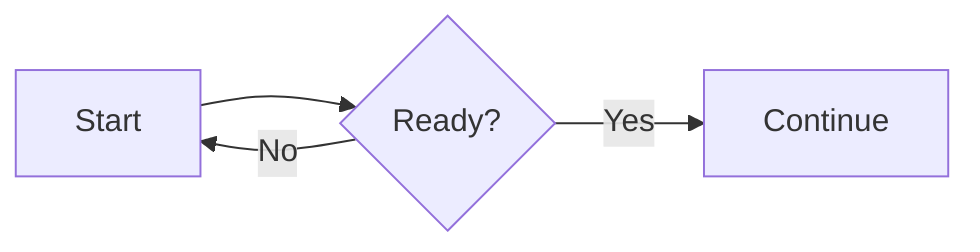

# Learper portable quiz file (v1)

Give this document to any chatbot. Learper imports its JSON output locally; no account or API key is needed.

## Request to paste into a chatbot

> Create a Learper v1 [quiz type] quiz about **[topic or supplied notes]** with **[number]** questions at **[difficulty]** difficulty. Use `"type": "[quiz type id]"` and follow only the matching question shape below. Create and attach a downloadable UTF-8 file named `learper-quiz.json` containing one JSON object, with no Markdown fences or commentary. If you cannot attach a file, provide the complete JSON in one `json` code block. If the source material is insufficient, say so instead of inventing facts. Use fenced `mermaid` blocks for diagrams when helpful; do not use image URLs.

## Common fields

The top-level object has `version` (always `1`), a unique `id`, a nonempty `title`, optional `description`, `type` (`"mcq"` or `"saq"`), and a nonempty `questions` array. Question IDs must be unique within a set. Each question has a nonempty `question`, optional `description`, and a `hints` array (use `[]` when there are no hints). Importing the same set ID replaces the earlier set. Old files without `type` still import as MCQ.

## Multiple choice (`"type": "mcq"`)

```json
{
  "version": 1,
  "id": "example-mcq",
  "title": "Example MCQ",
  "type": "mcq",
  "questions": [
    {
      "id": "q1",
      "question": "What is 2 + 2?",
      "hints": ["Add two to two."],
      "choices": [
        { "id": "a", "text": "3" },
        { "id": "b", "text": "4" }
      ],
      "correctAnswerId": "b",
      "explanation": "Two plus two is four."
    }
  ]
}
```

Each MCQ needs 2–6 choices with unique IDs and nonempty text, one matching `correctAnswerId`, and a nonempty `explanation`. Make distractors plausible. Keep the answer out of the question and choices. Learper grades each answer immediately.

## Short answer (`"type": "saq"`)

```json
{
  "version": 1,
  "id": "example-saq",
  "title": "Example SAQ",
  "type": "saq",
  "questions": [
    {
      "id": "q1",
      "question": "Explain why 2 + 2 equals 4.",
      "hints": ["Think of two pairs."],
      "explanation": "A complete answer explains that two objects combined with two more form a set of four."
    }
  ]
}
```

SAQ questions have no `choices` or `correctAnswerId`. The optional `explanation` is reference answer or grading guidance; it is hidden while the student answers and included in the final text copied for chatbot grading. Make questions clear enough to assess from the student's written answer. Learper does not assign scores to SAQs.

## Rich text and diagrams

Question, description, hint, choice, and explanation text support Markdown, inline `$...$` and display `$$...$$` LaTeX, plus fenced code blocks. C, C++, Python, and Rust code is highlighted. JSON strings must escape newlines as `\n` and LaTeX backslashes as `\\`.

Use a fenced `mermaid` block for a diagram. Mermaid flowcharts, sequence diagrams, class diagrams, and other supported Mermaid syntax are rendered locally:

````markdown

````

The same block in a JSON string begins `"```mermaid\nflowchart LR\n` and ends `\n```"`. Keep each diagram under 12,000 characters and 200 edges. Invalid syntax displays an inline error, leaving the rest of the question visible. Mermaid diagrams are rendered offline and cannot run links or scripts.

The optional `image` object with `url` and `alt` strings remains accepted for compatibility, but Learper does not fetch or display images. Prefer Mermaid for diagrams.

## Download and import

Download `learper-quiz.json` and choose **Import JSON…** in Learper. If the chatbot supplied JSON text, save it as a UTF-8 `.json` file or copy it and choose **Paste JSON**. The app validates the file before saving it locally.
